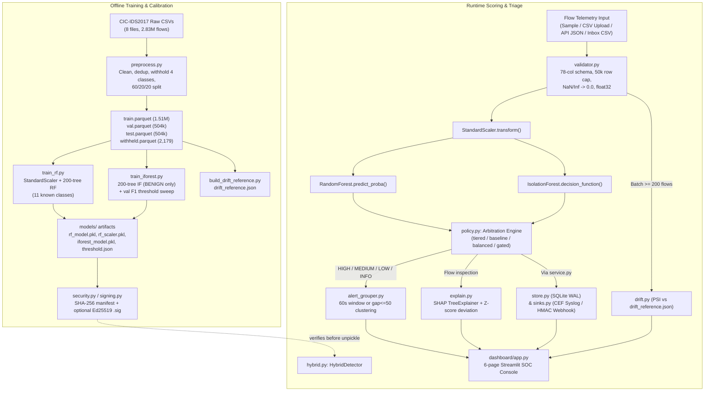
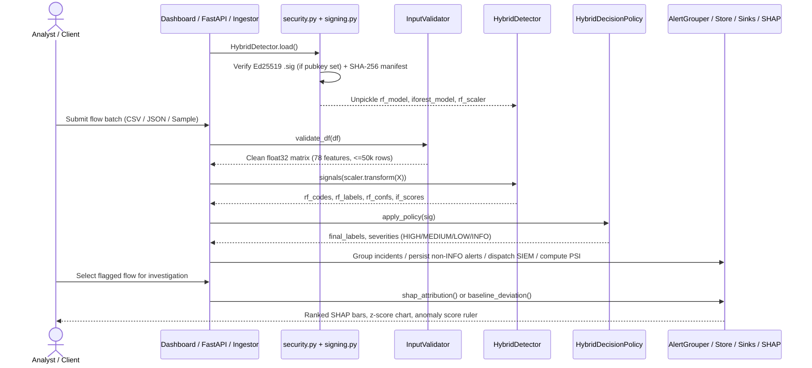

# 04 — Hybrid Detection Architecture

**Primary Modules:** `src/hybrid.py`, `src/policy.py`, `src/validator.py`, `src/security.py`, `src/explain.py`, `src/alert_grouper.py`, `src/service.py`

---

## 1. Reconstructed Actual Workflow vs. Proposal Template

The repository implements the complete proposed pipeline **and extends it** with cryptographic artifact verification, input schema/DoS validation, hot-swappable arbitration policies, and an optional production persistence/API/SIEM/drift layer:

1. **Input Ingestion** (Parquet sample / CSV upload / API JSON / `ingest_dir.py` inbox)
2. **Schema & DoS Guard** (`InputValidator`: 78 features, `<= 50,000` rows, `<= 50 MB`, `NaN`/`±Inf` -> `0.0`, `float32`)
3. **Cryptographic Load Gate** (`security.verify_artifact_integrity` + optional Ed25519 `signing.verify_manifest_signature` before `pickle.load`)
4. **Feature Scaling** (`StandardScaler` from `rf_scaler.pkl`)
5. **Parallel Model Scoring (`HybridDetector.signals`)**:
   - **Random Forest (`rf.predict_proba`)**: multiclass code, label, and max posterior probability `rf_confs`
   - **Isolation Forest (`iforest.decision_function`)**: continuous anomaly score `if_scores`
6. **Arbitration Policy Engine (`HybridDecisionPolicy.evaluate`)**:
   - **`tiered` (default in `config.py`, `dashboard/app.py`, `service.py`)**:
     - `RF != BENIGN` -> `final_label = rf_label`, `severity = HIGH`
     - `RF == BENIGN` and `if_score < -0.03` -> `final_label = "Anomaly (Unclassified)"`, `severity = MEDIUM`
     - `RF == BENIGN` and `-0.03 <= if_score < 0.061102` -> `final_label = "Anomaly (Marginal / Low Priority)"`, `severity = LOW`
     - `RF == BENIGN` and `if_score >= 0.061102` -> `final_label = "BENIGN"`, `severity = INFO`
   - **`baseline` (`BaselinePolicy`)**: `if_score < 0.061102` -> `MEDIUM`, else `INFO` (matches original proposal rule).
   - **`balanced` (`CalibratedThresholdPolicy(0.0)`)**: `if_score < 0.0` -> `MEDIUM`, else `INFO`.
   - **`confidence_gated` (`ConfidenceGatedPolicy`)**: suppresses marginal anomalies (`if_score >= -0.05`) when `RF == BENIGN` and `rf_conf >= 0.999`.
7. **Alert Grouping (`AlertGrouper`)**: Clusters non-`INFO` flows by `(final_label, severity[, src_ip, dst_ip])` using 60s tumbling windows (`Timestamp` present) or sequential index gap `<= 50` (max group `1,000`), requiring `>= min_alerts` (default `5`).
8. **Explainability (`explain.py`)**:
   - For `HIGH` alerts (and optionally any flow): `shap.TreeExplainer(rf)` computes signed Shapley attributions mapped via `rf.classes_` position.
   - For anomaly-only alerts (`MEDIUM`/`LOW`) where RF predicted `BENIGN`: `baseline_deviation()` computes per-feature z-scores against training mean/std.
9. **Presentation & Production Services**:
   - Streamlit SOC console (`dashboard/app.py`) renders overview, scans, incidents, per-flow explanations, alert history, and health/drift.
   - Optional `ScoringService` (`service.py`) backs `api/main.py` and `ingest_dir.py` with SQLite WAL storage (`store.py`), CEF syslog / HMAC webhook export (`sinks.py`), and PSI drift checks (`drift.py`).

**Status Verdict:** Hybrid detection logic is **COMPLETED** (fully vectorized NumPy implementation with 4 interchangeable policies and unit/regression test coverage).

---

## 2. High-Level System Architecture Diagram

---

## 3. End-to-End Execution Sequence (Runtime Scoring)

---

## 4. Module Dependency Map

- `dashboard/app.py` -> `soc_ui`, `auth`, `config`, `security`, `validator`, `hybrid`, `policy`, `alert_grouper`, `explain`, `drift`, `store`
- `api/main.py` -> `config`, `policy`, `service`, `store`, `validator`
- `src/ingest_dir.py` -> `config`, `service`, `validator`
- `src/service.py` -> `config`, `drift`, `hybrid`, `policy`, `sinks`, `store`, `validator`
- `src/hybrid.py` -> `config`, `policy`, `security`, `validator`
- `src/security.py` -> `config`, `signing` (lazy import when `IDS_MANIFEST_PUBKEY` is set)
- `src/evaluate_hybrid.py` -> `config`, `hybrid`, `policy`
